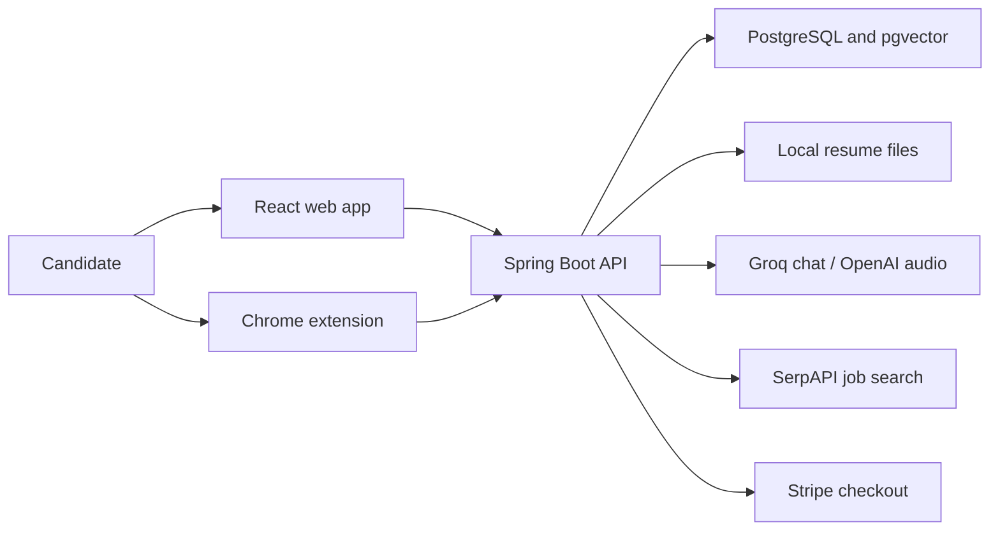

**Job Pilot — technical, product, and commercial assessment**

> Historical baseline. The first implementation pass is recorded in [STABILIZATION.md](STABILIZATION.md); build and security findings below describe the original reviewed version unless stated otherwise. The subsequent [resume versioning increment](RESUME-VERSIONING.md) addresses the original-overwrite and review-gate findings.

Assessment baseline: 22 October 2026. This report evaluates the supplied local repository and public competitor information retrieved during the review. Recommendations, proposed prices, timelines, and conversion targets are hypotheses for validation, not established business results.

**Decision: preserve the foundation, narrow the offering, and fix trust before selling.**

Job Pilot is a substantial prototype of an AI-assisted job-search workspace. It has enough implementation to justify further development, but the supplied version is not ready for a public paid launch. Several advertised workflows produce misleading state, access controls are inconsistent, the frontend production build fails, and billing does not implement the subscription described on the pricing page.

The strongest near-term product is a role-specific application workspace: select a real job, create a truthful tailored resume, review the changes, export an application packet, practice the interview, and track actual outcomes. Generic AI writing and a large roster of agent personas are weak differentiators in this market.

**What was examined and what was verified**

The repository contains 123 main Java files, 31 React page files, 15 SQL migrations, three backend test classes, and approximately 22,278 lines across application source, prompts, migrations, styling, and extension assets. The review traced authentication, resumes, job ingestion/search, applications, interviews, AI services, agent orchestration, networking, payments, storage, configuration, and extension behavior. These counts describe breadth, not quality or completion.

| Verification | Observed result |
|---|---|
| Locked frontend dependency installation | Completed with lifecycle scripts disabled |
| Frontend production build | Failed: unused declarations, missing `User.role`, nullable onboarding state, and missing Node types for Vite configuration |
| Frontend lint | Failed: ESLint 9 configuration file is absent |
| Clean backend compilation | Succeeded with Java 21 explicitly selected |
| Backend tests | 25 executed: 17 passed, 3 assertion failures, 5 errors |
| Test failure diagnosis | Eight credit tests use a string principal; production `SecurityUtils` requires `AuthenticatedUser` |
| npm dependency audit | 31 affected package entries: 1 critical, 19 high, 9 moderate, 2 low |
| Docker packaging inspection | Dockerfile copies `.mvn` and `mvnw`, which are absent from the supplied backend |
| Live end-to-end validation | Not performed: no verified running database, provider setup, payment account, or deployed environment was supplied |

The backend test run used a locally cached Byte Buddy agent as an explicit JVM argument to overcome this environment's self-attachment limitation. The resulting test failures are genuine fixture mismatches, not evidence that all eight underlying credit operations are broken. The audit did not change application source or automatically upgrade dependencies. Dependency installation and build attempts refreshed local generated artifacts.

Dependency audit counts do not mean 31 exploitable production vulnerabilities. Some advisories concern development tooling, Node-only paths, or unused dependencies. The critical entry is transitive `proxy-addr`; the frontend declares the MCP SDK but no application usage was found in the reviewed source. Confirm reachability, remove unnecessary dependencies, and upgrade in tested batches. Backend dependency vulnerability scanning remains outstanding.

Evidence: [backend verification log](/Users/manojkumar/Documents/job-pilot/docs/audit/backend-verification.log), [npm audit output](/Users/manojkumar/Documents/job-pilot/docs/audit/npm-audit.json).

**What the project is and who it serves**

Job Pilot is primarily a candidate-facing SaaS application, with a browser extension as a companion. It is not currently an employer ATS, recruiting marketplace, or verified recruiting-contact database. Its intended journey spans preparation, discovery, applications, interviews, and offers.

The architecture is a modular Spring Boot monolith, a React browser client, a Chrome Manifest V3 extension, PostgreSQL with pgvector, and third-party AI/search/payment services. Java 21, Spring Boot 3.3.5, Spring AI 1.0.0-M4, React 18, TypeScript, Vite 5, Tailwind, React Query, and Zustand are declared. Local file storage holds uploaded resumes. Redis is configured, but no substantive application cache, quota, or queue implementation using Redis was found.

The README describes OpenAI integration, while the default chat configuration points to Groq using a Llama model. Audio methods call OpenAI directly using the same configured key property. This mismatch makes setup and troubleshooting unreliable. Local transformer embeddings are intended; actual provider initialization and dimensional compatibility still need a startup integration test.

This diagram shows the implemented integration structure; it does not imply that every connection was verified live.

**Feature reality: implemented paths versus incomplete promises**

| Capability | Evidence in source | Assessment |
|---|---|---|
| Registration, login, onboarding | Password hashing, JWT issuance, profile and preferences | Implemented, needs session/security fixes and deployable API configuration |
| Resume upload and parsing | Tika extraction, AI JSON parsing, persistence | Useful foundation; scanned documents lack OCR, output validation needs strengthening |
| Resume builder and PDF | Structured editing and backend PDF generator | Partial user journey; builder export button still says coming soon |
| Resume tailoring | Job-specific AI rewrite and PDF generation | Implemented, but tailoring overwrites the base resume |
| ATS analysis and match scoring | LLM prompts returning scores and issues | Heuristic advice; no evidence of validation against real ATS behavior |
| Job import | Pasted text or server-side URL fetch | Implemented; URL fetch requires SSRF protection |
| Job research | pgvector query plus SerpAPI and AI ranking | Implemented paths with inconsistent embeddings and field mappings |
| Application tracker | CRUD, statuses, notes, counts | One of the stronger foundations; linked-resource ownership needs validation |
| Auto-apply | Creates database records marked `APPLIED` | Does not submit an external application |
| Email sync | Generates fictional recruiter emails and infers status | Demo behavior mutates real application records; disable before customer use |
| Networking | Generates placeholder contacts on empty search | Not a verified lead source; unsuitable for paid contact unlocks |
| Browser autofill | Field scanning and background API call | Local prototype; lacks authenticated backend request and deployment configuration |
| Mock interviews | Persistent sessions, personas, answers, report generation, audio calls | Meaningful implementation, needs ownership checks, quotas, and quality evaluation |
| Salary and culture advice | Prompt-based analysis with persistence | No live source retrieval in these services; sources/confidence may be invented |
| LinkedIn optimizer | Generated profile text | Writing assistant, not a verified profile integration |
| Outreach sequences | Generates and saves email drafts and nominal dates | Draft generator; no actual dispatch pipeline or reply handling found |
| Agent command center | Synchronous and SSE workflows with personas | Orchestration prototype; not durable autonomous execution |
| Billing | Stripe one-time checkout and role upgrade | Conflicts with monthly plan; webhook is blocked by normal JWT requirement |
| Usage/model management | Logs, model records, weighted selection, feedback | Partial instrumentation; actual call does not apply selected model |
| Fine-tuning | Scheduled harvesting of selected prompt/response pairs | Dataset preparation only; no training/deployment pipeline |

**Launch-blocking findings and required corrections**

Priorities below are engineering and commercial priorities, not formal CVSS ratings. Static findings should receive focused regression tests before exposure to real customers.

| Priority | Finding and consequence | Concrete correction and acceptance check |
|---|---|---|
| P0 | Email sync manufactures recruiter messages and changes statuses, including offers/rejections | Disable this route outside an isolated demo. Require source message ID and evidence for future automated transitions. A real user's status must never change from synthetic content. |
| P0 | Auto-apply marks jobs applied without submitting them | Rename to save/prepare and use a draft state. Require explicit user confirmation or a verified submission receipt before `APPLIED`. |
| P0 | Networking creates names, emails, and LinkedIn URLs from placeholders | Remove fabricated production contacts. Use user-entered contacts or licensed, attributable records with verification dates. Never charge for invented contact details. |
| P0 | Resume ownership gaps in copilot mapping and interview context | Require authentication and query resumes by both ID and current user. Add two-user tests for every ID-based operation. UUID unpredictability is not authorization. |
| P0 | Model administration endpoints have no admin role enforcement | Enforce admin access in backend policies, not merely navigation. An ordinary user must receive 403 on every model mutation. |
| P0 | Credential-like SerpAPI value and known JWT fallback are in configuration | Remove secret defaults; rotate the SerpAPI value if real and active. Require production secrets at startup. Do not test the exposed key. |
| P1 | Access and refresh tokens are not distinguished when accepted | Validate token purpose, issuer/audience, account status, rotation, and revocation. Test that a refresh token cannot call resource APIs and an access token cannot refresh sessions. |
| P1 | Pricing says monthly; checkout uses one-time payment and permanent `PRO` role | Choose a time-limited pass or actual subscription. Keep subscription state separate from authorization roles. Implement expiry/cancellation/payment failure/refund behavior and replay-safe webhooks. |
| P1 | Stripe webhook is covered by `.anyRequest().authenticated()` | Permit only that webhook endpoint without user JWT, retain signature verification, and test events without a browser session. |
| P1 | SSE executor reads thread-local security inside an unmanaged thread | Propagate security context correctly or capture authorized user identity before enqueueing. Bound concurrency, cancel work on disconnect, and test an authenticated streamed workflow. |
| P1 | Frontend build and lint fail; Dockerfile references missing wrapper files | Restore reproducible clean builds, lint, CI and packaging. These are release gates. |
| P1 | Authentication and extension URLs are hardcoded to localhost | Use one environment-aware API client/configuration and verify a production-origin login and extension request. |
| P1 | User-supplied URLs reach `Jsoup.connect` directly | Restrict protocols, reject private/loopback/link-local destinations and unsafe redirects, impose response limits and use restricted egress. |
| P1 | Credit checks and deductions are separate read/modify/write operations | Reserve cost atomically, meter every provider path, settle/refund according to outcome, and add concurrency tests. |
| P1 | Resume JSON edits leave raw text and embeddings stale; PDF tailoring overwrites original | Introduce immutable resume versions and regenerate canonical text/embeddings. Downloads must not silently mutate source material. |
| P1 | “Admin model routing” logs a selected model without setting it on the AI request | Apply model/provider configuration to the request, record returned metadata, and verify different routes actually invoke different configured models. |
| P1 | AI logs and harvested datasets contain full candidate content | Define consent, retention and deletion across originals, outputs, logs, embeddings, datasets and backups. Disable training-data reuse by default until explicit consent exists. |
| P2 | Contact search returns full entity fields before paid unlock | Return a masked DTO until entitled; persist unique user/contact unlocks so repeat access is not charged again. |
| P2 | Search writers and readers disagree on field/storage schema | Standardize job DTO keys and a single embedding source. Test imported and discovered jobs using the same ranking query. |
| P2 | Missing reset routes/email delivery, incomplete free-plan enforcement | Implement the published account and plan behavior or remove those promises. |

Copilot security nuance: its route is public and its resume lookup lacks ownership checks. However, the downstream credit service requires an authenticated principal and the mapping function swallows errors. Therefore unauthenticated access is not proven to return resume contents; an authenticated user supplying another resume ID remains a serious static authorization defect. The extension currently sends no bearer token, so it may receive an empty mapping reported as success.

The refresh-token filter can accept a signed refresh token as an authenticated identity because it does not reject `type=refresh`; the resulting authority is not a valid user role, but many routes only require authentication. The refresh service also accepts any valid signed token and does not check `enabled`. These issues deserve explicit tests rather than relying on the short access-token lifetime.

Relevant source anchors:

- [Synthetic email transitions](/Users/manojkumar/Documents/job-pilot/backend/src/main/java/com/jobpilot/application/service/EmailSyncService.java:55)
- [Auto-apply writes database records](/Users/manojkumar/Documents/job-pilot/backend/src/main/java/com/jobpilot/ai/service/AgentService.java:206)
- [Fabricated contact fallback](/Users/manojkumar/Documents/job-pilot/backend/src/main/java/com/jobpilot/networking/service/HiringManagerService.java:69)
- [Copilot resume lookup](/Users/manojkumar/Documents/job-pilot/backend/src/main/java/com/jobpilot/application/controller/CopilotController.java:35)
- [Interview resume lookup](/Users/manojkumar/Documents/job-pilot/backend/src/main/java/com/jobpilot/interview/service/InterviewService.java:128)
- [Admin model API](/Users/manojkumar/Documents/job-pilot/backend/src/main/java/com/jobpilot/ai/controller/NewFeaturesController.java:162)
- [Route security and CORS](/Users/manojkumar/Documents/job-pilot/backend/src/main/java/com/jobpilot/common/config/SecurityConfig.java:45)
- [Refresh validation](/Users/manojkumar/Documents/job-pilot/backend/src/main/java/com/jobpilot/auth/service/AuthService.java:67)
- [One-time checkout](/Users/manojkumar/Documents/job-pilot/backend/src/main/java/com/jobpilot/user/service/StripeService.java:38)
- [Streaming thread identity](/Users/manojkumar/Documents/job-pilot/backend/src/main/java/com/jobpilot/ai/agent/StreamingAgentOrchestrator.java:44)
- [Tailoring mutates base resume](/Users/manojkumar/Documents/job-pilot/backend/src/main/java/com/jobpilot/resume/service/ResumeService.java:159)
- [Selected model not applied](/Users/manojkumar/Documents/job-pilot/backend/src/main/java/com/jobpilot/ai/service/AiService.java:467)
- [Hardcoded login origin](/Users/manojkumar/Documents/job-pilot/frontend/src/store/authStore.ts:5)

Spring's documentation confirms that security context is normally thread-bound and provides delegating executors for propagation. Stripe documents the asynchronous events needed to keep subscription access correct. [Spring concurrency support](https://docs.spring.io/spring-security/reference/features/integrations/concurrency.html), [Stripe subscription webhooks](https://docs.stripe.com/billing/subscriptions/webhooks).

**Architecture strengths and limits**

Keep the modular monolith. Domain packages, migrations, DTOs, BCrypt password hashing, many user-scoped repository queries, configurable file-storage interfaces, and relational persistence are useful foundations. PostgreSQL plus pgvector is sufficient for the initial product; there is no demonstrated need for another vector database, microservices, Kubernetes, or a rewrite in another language.

The current architecture nevertheless needs the following structural work:

- Separate slow provider calls from long database transactions. Resume upload, job analysis, email sync, and interview operations currently mix network work with transactions.
- Publish embedding work after commit or through an outbox. An async task started before the parent transaction commits can race the new row and fail foreign-key writes.
- Fix split embedding storage. Normal job ingestion writes `job_embeddings`, while agent retrieval sorts `jobs.embedding`; some agent-created jobs set the latter directly and others do not.
- Use typed provider/job responses. SerpAPI produces `company` and `url`, while both orchestrators read `companyName` and `jobUrl`, losing source information.
- Consolidate synchronous and streaming orchestration into one execution engine with different response transports. Persist workflow state, step results, retry keys, and cancellation status.
- Introduce one provider gateway for quotas, timeouts, retry budgets, schema validation, actual token usage, latency and cost. Interview/research/networking paths currently bypass parts of the credit/logging system.
- Use private object storage for documents with bounded signed access, lifecycle policies and restore procedures. Local disk is fragile across restarts and multiple instances.
- Restrict CORS to configured web origins and intentional extension access. Wildcard credentialed CORS and browser-local token persistence increase the consequences of other weaknesses.
- Centralize schema and error contracts. Avoid returning HTTP success with a hidden AI error and charging a credit before validating the output.

A sensible next deployment is a static frontend behind a CDN, one API service, one background-worker deployment using the same codebase, managed PostgreSQL, private object storage, and managed secrets. Add Redis only for a measured caching/rate-limiting/queue need. Introduce workload and spend limits before scaling instance counts.

No capacity number is defensible from this repository alone. Load-test document processing, concurrent AI workflows, database connection occupancy, retry storms, and stream disconnections using stubbed providers before spending on live-provider load tests.

**Product scope for the first sellable release**

Make one workflow excellent: upload and correct a base resume → paste a job description → inspect fit and missing evidence → generate a version with a visible diff → approve and export → save the application → practice that role's interview → record actual feedback.

Expose approximately five top-level areas: Jobs, Applications, Resumes, Interview Practice, and Account. Attach cover letters and preparation tools to a specific job. The existing spread of separate AI-tool pages forces users to reconstruct context and understand implementation concepts.

Keep manual tracking, resume editing/export, job-specific tailoring, explainable fit checks and text interviews in the release. Add reminders, a reusable factual answer bank, document versions and real application evidence. Defer autonomous submission, fabricated lead discovery, unattended outreach, fine-tuning controls, and broad culture scores.

The first-session outcome should be a useful application packet, not an agent log. Show editable extracted facts, missing-information questions, progress, failure recovery, and clear credit cost before work starts. Preserve work when an AI provider fails. Make pricing public; it is currently behind the protected onboarding flow. Verify the provenance of the homepage's testimonial claims before publishing them.

**AI quality: where to invest**

1. Build a candidate evidence store. Maintain confirmed employers, dates, education, projects, skills and achievements. Associate generated claims with evidence IDs. If the job asks for an unsupported skill, show a gap instead of adding it to the resume.
2. Treat tailoring as a constrained edit. Return typed proposed changes, reasons, and supporting facts. Let the user accept or reject changes. Keep source and derived versions immutable and record which version was used for each application.
3. Separate parseability, keyword coverage, experience relevance and preferences. A single LLM-generated “ATS score” is not an acceptance probability. Plain text alone cannot reliably establish the original PDF's column/table layout; add document-layout checks and parsing tests.
4. Ground research in retrieved sources. Job and company claims need source URLs and timestamps. Salary advice needs geography, currency, level, compensation components, evidence and explicit uncertainty. The current salary prompt requests USD and does not include the submitted offer amount in the analysis prompt.
5. Create a small, consented evaluation set before model experiments: for example, 100 resume/job pairs and 30 interview sessions across the intended roles. Measure unsupported claims, field extraction, usable export rate, relevance, human preference, cost and latency.
6. Protect tool execution from document instructions. Treat resumes, webpages and job descriptions as untrusted data. Tool permissions, recipients, destinations and submission decisions must come from validated application state and user approval.
7. Implement model routing only after evaluations can compare results. Use cheaper models for extraction and more capable models only where measurable output quality justifies the cost. A self-reported score increase is not a valid training label by itself.

**Market position and competition**

The category has established products with substantial feature overlap. Current public listings show:

| Competitor | Published offer/pricing | Implication for Job Pilot |
|---|---|---|
| Teal | Free tracking/resumes; Teal+ lists $29 per 30 days, with shorter/longer options | Tracking and generic resume writing alone are difficult paid differentiators |
| Simplify | Free matches/autofill/tracker; Simplify+ lists $39.99 for one month | An extension plus AI writing is already a competitive baseline |
| Huntr | Free tier; Pro lists $40 monthly | A unified resume/tracking workspace is not an empty category |
| Jobscan | Official comparison lists $49.95 monthly or $89.95 quarterly | ATS-oriented optimization is an established paid category, but pricing does not prove demand for this product |

Sources: [Teal pricing](https://www.tealhq.com/pricing), [Simplify free product](https://simplify.jobs/), [Simplify+ plans](https://help.simplify.jobs/en/help/articles/5623502-whats-included-in-simplify-features-and-pricing), [Huntr plans](https://help.huntr.co/en/articles/9806024-faq), [Jobscan's published pricing comparison](https://www.jobscan.co/blog/jobscan-vs-teal/). Prices can change; taxes, eligibility, promotions and checkout terms were not independently tested. These are vendor descriptions, not independent performance evidence.

Simplify also documents actual submission through Autopilot. “Autonomous applications” therefore would not create a unique category even after implementation. [Simplify Autopilot](https://help.simplify.jobs/articles/1784339-getting-started-with-autopilot).

Users also compare this product with their existing AI assistant, a spreadsheet and manual browser workflows. Job Pilot must save repeated work and preserve reliable context better than that combination. “Powered by agents” is a technical description, not a compelling purchase reason.

**Recommended initial audience and differentiation**

Working assumption: start with India-based software professionals with roughly 2–8 years of experience changing jobs, initially one family such as Java/backend roles. INR checkout is the repository's strongest geographic clue; this is a proposed focus, not confirmed customer research. Validate the audience before investing heavily in localization.

Potential advantages to test are verified resume claims, role-specific interview depth, notice-period and location preferences, INR compensation breakdowns, readable application version history, and coach-assisted review. These need real product implementation and customer evidence; none is automatically a moat.

Suggested positioning: “Prepare a truthful, role-specific application and interview plan in one workspace, with every version and follow-up organized.” Demonstrate saved time before claiming better hiring outcomes.

| Segment | Attraction | Constraint | Recommendation |
|---|---|---|---|
| Experienced technical candidates | Clear role context and measurable preparation tasks | Job search is episodic; repeat subscription use may be short | First direct-user test |
| Students/freshers | Accessible cohorts and institutional channels | Price sensitivity and seasonal usage | Test through placement partners after core workflow works |
| Career coaches/training programs | Repeat cohorts; potential distribution partners | Need review workflows, permissions and reporting | Parallel discovery, then a small paid pilot |
| Enterprise outplacement | Potentially larger contracts | Procurement, security review and integrations | Later expansion |
| Recruiter sourcing/contact sales | Superficially adjacent | Different buyer and data business; current contacts are fabricated | Exclude from initial scope |

Defensibility would come from trusted workflow history, role-specific evaluation quality, distribution relationships, and consented outcome feedback. It would not come from calling several prompts “agents.”

**How to sell it**

Start with founder-led discovery and demonstrations, then scale a channel only after observed conversion and contribution margin support it.

1. Interview 20–30 target candidates and 5–10 coaches or placement leads. Observe their last real application, current tools, preparation time and what they have actually paid for. Avoid hypothetical “would you use this?” questions.
2. Recruit about 50 qualified beta users from relevant professional communities and coach referrals, with permission from community owners. Help them complete one real application packet. Record failures and time saved with consent.
3. Seek the first 10–20 paying users through a bounded job-search pass. Require actual payment to validate willingness to pay; free-user praise is insufficient.
4. Run a small coach/cohort pilot with named review responsibilities, a fixed usage allowance, and an agreed report. Add organization features only when required by that pilot.
5. Publish useful role-specific demonstrations: a factual before/after resume diff, a backend interview rubric, and an application follow-up workflow. Use genuine, permissioned customer evidence. Avoid unsubstantiated “guaranteed interview” or “ATS pass” claims.
6. Test referrals and partnerships before broad paid ads. Track landing visit → qualified signup → first approved packet → second-week usage → paid conversion → verified interview → job-search completion.

An effective two-minute demo uses one real-looking consented/sample resume and one real job: highlight evidence gaps, approve three edits, export the packet, save its version to the tracker, and generate three role-specific practice questions. Label all demo data. The user should see the practical result before agent terminology.

For institutions, sell reduced advisor review time and better visibility into candidate preparation, not guaranteed placements. The current product lacks organizations, memberships, advisor roles, cohort reporting and institution-level billing, so it cannot yet be presented as an enterprise-ready platform.

No defensible market-size or revenue forecast can be derived from code. Build a bottom-up model from reachable candidates and partners: qualified traffic × activation × paid conversion × net revenue per buyer, plus partners × active seats × net price per seat. Measure these inputs rather than multiplying a global job-seeker estimate by an arbitrary market share.

**Pricing and unit economics**

The current ₹2,499/month page conflicts with one-time checkout and unlimited access. Fix that contract first. Avoid unlimited costly workflows until costs and abuse patterns are measured.

Illustrative experiments, not recommended permanent list prices:

| Offer | Test hypothesis | Usage design |
|---|---|---|
| Free | Manual tracker, basic resume editing/export, one complete application packet | Let users see a finished result before paying |
| 30-day Job Search Pass | Test ₹799 versus ₹999 with comparable cohorts | A defined number of application packets and text interviews; show limits clearly |
| 90-day Pass | Test around ₹2,499 after 30-day value is proven | Term-limited access and documented periodic allowances |
| Coach/cohort pilot | Test a minimum pilot fee plus ₹200–₹400 per active learner/month | Usage caps, aggregate reporting and bounded onboarding support |

Do not offer all price variations to one small cohort at once. Start with one clear offer, track objections and conversion, then test a meaningful alternative. Voice usage and premium review may need separate allowances. Confirm local payment-method support through the actual provider account before displaying UPI claims.

Illustrative monthly contribution model for ₹999 net revenue per customer: ₹50 payment/refund allowance + ₹80 AI + ₹40 search/data + ₹40 hosting/storage + ₹90 support = ₹300 variable cost, leaving ₹699 contribution (about 70%). These are planning assumptions, not observed costs or current vendor quotes; salary, acquisition, fixed engineering costs and taxes are outside this example. If ₹999 is tax-inclusive, first reduce it to net revenue and recompute.

An illustrative acquisition spend of ₹600 would take about 0.86 paid months to recover at ₹699 contribution/month. Two paid months would contribute ₹1,398 before acquisition; observed paid duration could be shorter. Job-search completion can be healthy churn, so measure outcomes and referrals instead of trying to keep successful users subscribed unnecessarily.

Track cost per accepted application packet, cost per completed interview, P95 cost per user, retries, search requests, support minutes, refunds and customer acquisition cost. The existing usage dashboard cannot support these decisions while token counts are zero or absent and not all AI paths are metered.

**Technology enhancements ranked by value**

| Order | Enhancement | Customer or business value |
|---|---|---|
| 1 | Immutable resume versions, evidence-backed edits and reliable PDF export | Trustworthy output and recoverable application history |
| 2 | Central AI gateway, schema validation, usage ledger and evaluation suite | Predictable quality and controllable costs |
| 3 | Saved answers, job-linked preparation and follow-up reminders | Less repetition and stronger repeat usage |
| 4 | Source-attributed job import, deduplication, freshness and preference filters | Better opportunity selection |
| 5 | Real application event timeline with source evidence | Honest metrics and useful outcome learning |
| 6 | Bounded workers/outbox, retries, cancellation and observable workflows | Reliability when providers or connections fail |
| 7 | Secure extension authentication and supported-site adapters | Faster assisted application entry |
| 8 | Consented email import and calendar integration | Reduced manual tracking, after integration obligations are understood |
| 9 | Role-specific interview rubrics and reviewed feedback | Deeper differentiation than generic questions |
| 10 | Organizations, advisor review, seats and cohort reports | Enables validated coach/placement sales |

Start email automation with user-forwarded or explicitly imported messages where appropriate, maintaining provenance and deletion controls. A full Gmail integration is a separate deliverable: Google's documentation categorizes broad read scopes as restricted and describes verification/security-assessment requirements for server handling. Budget for those requirements rather than treating it as a quick API connection. [Gmail scopes](https://developers.google.com/workspace/gmail/api/auth/scopes).

Treat employer-site automation and LinkedIn automation separately. LinkedIn explicitly restricts third-party scraping and automation; adding a user confirmation button does not by itself establish permission. The current extension includes LinkedIn matches. Review each supported site's terms, prefer authorized integrations, and avoid marketing unrestricted LinkedIn automation. [LinkedIn automated activity policy](https://www.linkedin.com/help/linkedin/answer/a1341543).

**90-day execution plan and release gates**

Planning assumption: two experienced full-stack engineers, a product/founder owner, and part-time QA/design support. This is a sequencing proposal, not a delivery guarantee; payment/provider approval and customer research can alter timing.

| Period | Engineering work | Commercial work | Exit evidence |
|---|---|---|---|
| Days 1–14 | Disable misleading features; fix ownership/admin/token issues; remove secret defaults; restore builds/tests and Docker packaging | Conduct target-customer interviews; simplify product claims | Clean CI; two-user authorization tests; no synthetic production transitions |
| Days 15–30 | Canonical resume versions, reviewable tailoring/export, tracking, provider configuration, coherent payment entitlement | First assisted beta sessions and pricing discovery | One complete workflow on a deployed test environment; payment lifecycle tests |
| Days 31–60 | AI evaluation, atomic quotas, accurate usage/cost logs, source attribution, reminders, backups and restore test | About 50 qualified beta users; seek 10–20 paying users | Recorded activation, time saved, support load and contribution costs |
| Days 61–90 | Fix observed friction; add only validated integration or advisor features | One to three small partner pilots; compare acquisition channels | Evidence of repeat use and willingness to pay; release decision based on gates |

Suggested internal targets, not industry benchmarks: at least 40% of qualified signups finish their first approved packet; at least 30% of still-active job seekers return in week two; at least 10% of activated users pay in an initial offer test; median first-packet time below five minutes after inputs are ready; variable costs below 30% of net revenue. Small samples are directional and should not support broad marketing claims.

Quality gates are separate from conversion targets: no known cross-user access, no false submission/sync claims, no unsupported factual additions in the release evaluation set, at least 95% successful parse/export on supported test documents, replay-safe billing, graceful provider failure, deletion exercised across stored data, and a demonstrated restore. Report all finite-test limits honestly; zero failures in a test set does not prove zero future failures.

Test strategy should cover real risks: Testcontainers-based PostgreSQL/pgvector migration and ownership tests; mocked-provider contract tests; concurrent credit reservation; webhook duplicates and out-of-order events; resume round-trip/export checks; and browser flows for onboarding, tailoring, export, tracking and upgrade. Add extension fixtures for each supported form family. Fix the existing credit-test principal mismatch rather than weakening production authentication to satisfy tests.

**Boundaries and remaining decisions**

No live security exploit, external application submission, email send, payment, deployment, or customer-data operation was performed. No customer interviews, production traffic, retention, revenue, paid acquisition data, real provider bills or ownership/licensing records were available. Browser layout, accessibility, live AI quality, migrations against an actual database, and production recovery remain unverified.

The repository's README also overstates setup readiness: it lists a frontend test command that does not exist, describes configuration that differs from defaults, and references an MIT license file that was not found. Resolve dependency/code provenance and publish an actual license decision before distributing source or offering white-label rights.

The next management decisions are the initial customer segment, one paid offer, the supported first workflow, team capacity and pilot budget. The immediate engineering work is already clear: truthful behavior, tenant isolation, reproducible delivery and trustworthy artifacts. Those foundations give the project a credible path to a paid pilot; adding more standalone AI tools does not substitute for them.

## Implementation follow-up — 24 October 2026

The assessment above remains the strategic baseline. Resume review/versioning and the next provider/failure-correctness increment are implemented; see [STABILIZATION.md](STABILIZATION.md), [RESUME-VERSIONING.md](RESUME-VERSIONING.md), and [AI-PROVIDER-STABILIZATION.md](AI-PROVIDER-STABILIZATION.md) for exact scope and evidence. All chat features now apply database-selected models through a shared Spring AI service. OpenAI audio credentials are separate from Groq chat, simulated audio is removed, and workflow failures reach both API and UI as failures. This does not complete the roadmap: durable workflows, atomic credit accounting, provider quality evaluation, security hardening and the pilot launch gates remain open.

### Workflow persistence follow-up

Agent Command Center history and drafts now persist in PostgreSQL, with one execution path for synchronous and streamed requests. Users can reopen completed outputs and resume failed/interrupted runs without regenerating recorded completed steps. Database integration tests cover ownership, restart reconstruction, concurrent attempts and atomic job imports. See [WORKFLOW-PERSISTENCE.md](WORKFLOW-PERSISTENCE.md) for the 116-test verification result and limitations. This is user-triggered recovery; Temporal integration, automatic recovery, cancellation, credit reservations and provider-quality evaluation remain open. The Temporal section includes a single-workflow design evaluation and the Spring AI version compatibility finding, not a runtime prototype.

### Credit accounting follow-up

V19 adds a separate spendable balance, atomic reservations and an owner-scoped provider usage ledger. All shared chat/audio calls now participate, including previously uncharged research/interview routes. Successful workflow results are cached with their settlement and reused after checkpoint failure; unknown outcomes require explicit operator reconciliation. Verification: 131 backend tests (44 with PostgreSQL), frontend build passed, lint zero errors/70 warnings. See [CREDIT-ACCOUNTING.md](CREDIT-ACCOUNTING.md). This completes the app-credit concurrency/recovery increment. It does not establish monetary provider billing, subscription correctness, strict structured-output validity or production deployment readiness.

### Search and saved-job integrity follow-up — 25 October 2026

The split embedding store and fire-and-forget delivery issues are addressed: all job ingestion paths feed a persisted queue, and retrieval reads the same canonical embedding tables with owner and completion filters. V20 also protects job/tracker saves under concurrency while retaining historical records. Research ranking uses source-backed candidate IDs instead of generated listing fields or fuzzy save matching. Verification: 152 backend tests, including 66 database tests, frontend build passed, lint zero errors/70 warnings. See [SEARCH-INTEGRITY.md](SEARCH-INTEGRITY.md) for migration/rebuild behavior and limits. Production deployment, semantic quality evaluation, URL-fetch security, retention, provider monetary accounting and launch gates remain open.
